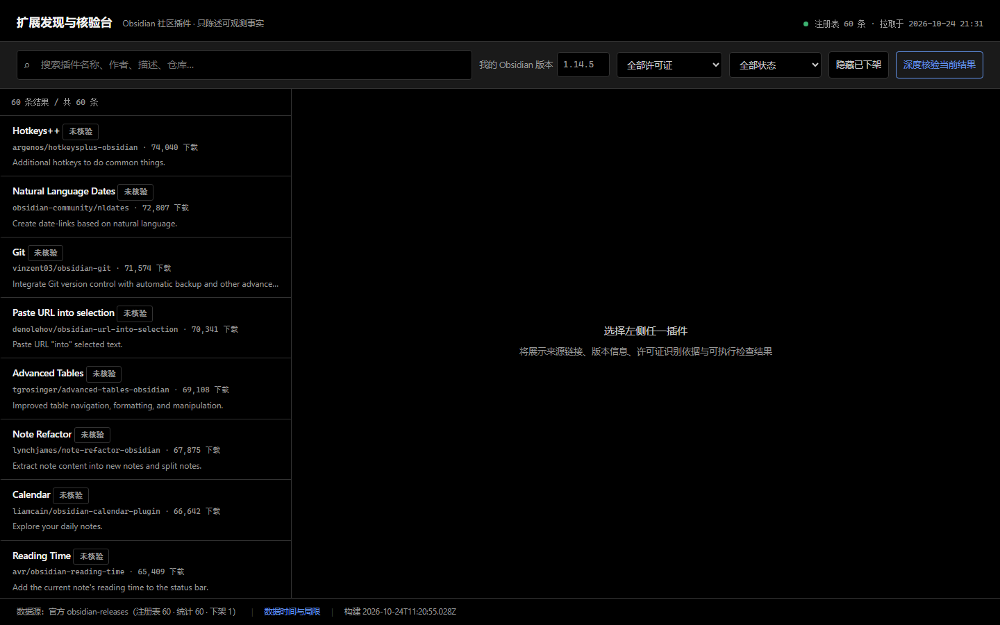
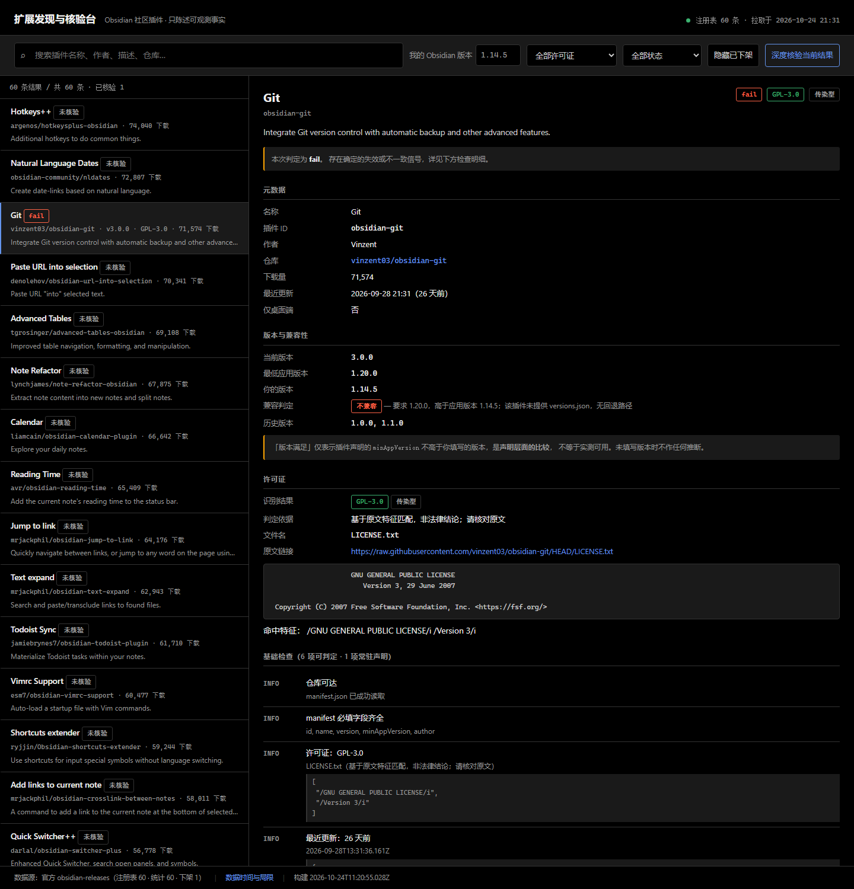
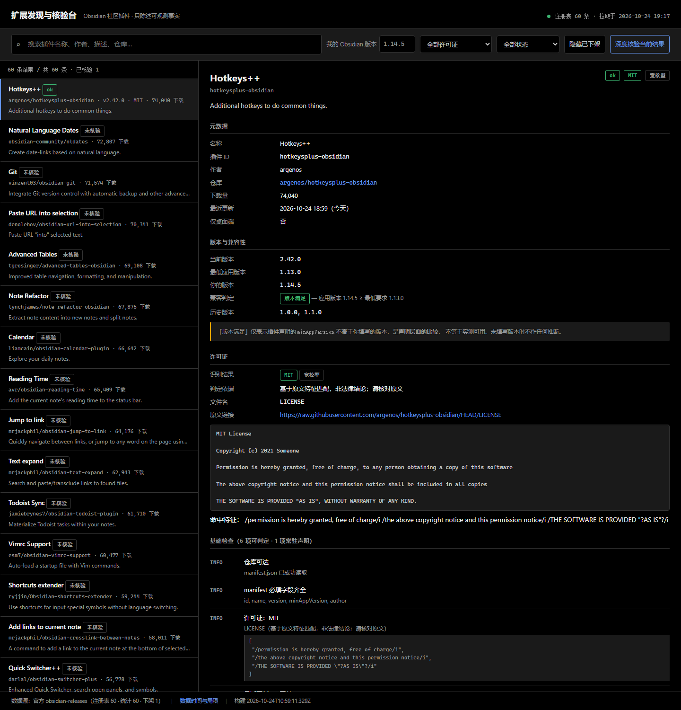
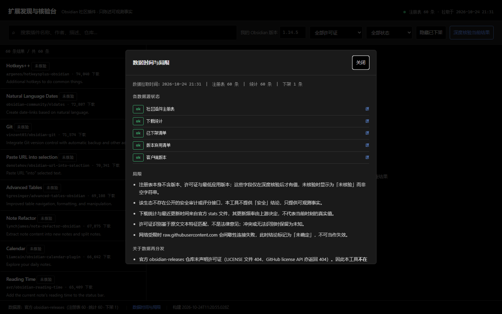

# 扩展发现与核验台

针对 **Obsidian 社区插件生态**的插件发现与可执行核验工具。零第三方依赖，纯 Node.js stdlib。



<details>
<summary>更多界面截图</summary>

**判定为 fail：minAppVersion 1.20.0 高于用户版本 1.14.5**



**判定为 ok：许可证识别、版本比较、检查项与来源链接**



**数据时间与局限（含各数据源状态与来源地址）**



</details>

## 为什么做这个生态

选择依据是核实过的数据，不是印象（完整实测见 `docs/FINDINGS.md`）：

- 官方注册表 `community-plugins.json` 有 **9389** 条，但每条只有 **5 个字段**：`id / name / author / description / repo`
- **版本、最低应用版本、许可证都不在注册表里**，它们分散在每个插件各自的 GitHub 仓库中
- 官方**不存在**任何公开的质量评分或安全审计接口
- 插件本体分布在约 9000 个互相独立的第三方仓库

结论：这是一个真实的「资源分散、缺少统一发现与质量核验机制」的生态。

## 核心立场

这个工具**不会**做的事，是它最重要的设计约束：

| 不做 | 原因 |
|---|---|
| 不标注「安全」 | 该生态没有公开安全评分；本工具不做代码审计。界面上每个插件都常驻一条「无官方安全评分可查」声明 |
| 不把网络失败当失效 | 实测 500 条抽样中首轮 257 条连接失败，重试后 **225 条恢复、0 条真 404**。若判为失效将产生 51% 假阳性 |
| 不猜许可证 | 只做原文文本特征匹配；冲突或无法识别时保留为「未知」，并附原文链接与命中特征供人工复核 |
| 不擅自抓取受限数据 | 只访问官方公开只读 JSON；未使用 GitHub API 的高频端点 |
| 不分发数据集 | 官方仓库未声明许可证（LICENSE 404），因此交付包内**不含任何数据快照**，全部运行时读取 |

## 三种判定状态

```
fail     存在确定性失效信号：404、官方下架、ID 不一致、版本不兼容
warn     存在已确认瑕疵：缺许可证文件、缺字段、超两年未更新
unknown  无法判定：网络失败、字段未声明 —— 绝不折叠成 fail 或 ok
```

`ok` 只表示「本次可执行的检查未发现问题」，不等于「安全」或「推荐安装」。

## 快速开始

```bash
# 1. 看数据源状态与局限
node tools/cli.mjs sources

# 2. 搜索
node tools/cli.mjs search git --limit 10

# 3. 核验指定插件（会读取 manifest、versions.json、LICENSE 原文）
node tools/cli.mjs verify obsidian-git templater-obsidian --app 1.14.5

# 4. 随机抽样，看整体分布
node tools/cli.mjs audit --sample 40 --app 1.14.5

# 5. 建立本地缓存（网络不稳时强烈建议）
node tools/cli.mjs cache --cache-dir data/cache

# 6. 用缓存离线运行（数据年龄会显示在输出里）
node tools/cli.mjs search git --offline --cache-dir data/cache
```

图形界面：直接双击 `web/dist/ext-audit.html`，无需服务器。

在线演示：<https://llinok111.github.io/ext-audit/>

> 演示页会实时从官方地址读取数据，因此需要能访问 `raw.githubusercontent.com`。演示页内的「深度核验」会逐个读取插件仓库的 manifest 与许可证原文，响应速度取决于网络。

## 输出示例

```
Git  [ok]
  id            obsidian-git
  repo          vinzent03/obsidian-git
  版本          2.42.0  (minApp 1.13.0)
  许可证        MIT (LICENSE)
  兼容判定      compatible — 应用版本 1.14.5 ≥ 最低要求 1.13.0
  检查项：
    [info   ] 仓库可达
    [info   ] manifest 必填字段齐全
    [info   ] 许可证：MIT
    [info   ] 版本要求满足
    [unknown] 无官方安全评分可查 (常驻)
```

## 退出码

| 码 | 含义 |
|---|---|
| 0 | 无 fail、无 unknown |
| 1 | 存在 fail |
| 2 | 存在 unknown（常见于网络受限，不代表插件有问题） |
| 3 | 运行错误 |

可直接用于 CI 或脚本判断。

## 检查项清单

| id | 判定 | 说明 |
|---|---|---|
| `repo-reachable` | ok / fail / unknown | manifest.json 是否可取；404 才算 fail |
| `manifest-complete` | warn | `id/name/version/minAppVersion/author` 是否齐全 |
| `manifest-id-match` | fail | manifest.id 与注册表 id 是否一致 |
| `registry-meta` | warn | 注册表 `description/author/repo` 是否缺失 |
| `license-declared` | info / warn / unknown | 许可证识别结果，含依据与原文链接 |
| `version-compat` | info / fail / unknown | `minAppVersion` 与用户版本的比较 |
| `official-removed` | fail | 是否在官方下架清单（175 条） |
| `deprecated-version` | warn / fail | 当前版本是否被官方标记弃用 |
| `last-update` | info / warn | 距 `stats.updated` 的天数，>730 天为 warn |
| `versions-map` | info | 是否提供 `versions.json`（影响低版本回退） |
| `security-baseline` | unknown（常驻） | 显式声明无安全评分可查，**不参与状态汇总** |

## 目录结构

```
ext-audit/
├── src/
│   ├── sources.mjs    数据源定义、三态抓取（ok/missing/unknown）、重试
│   ├── license.mjs    许可证文本特征识别（含 LGPL/GPL 互斥）
│   ├── verify.mjs     版本比较、兼容判定、检查项、状态汇总
│   ├── indexer.mjs    多源合并、深度核验、可解释搜索
│   └── cache.mjs      带 sha256 校验的本地缓存
├── tools/
│   ├── cli.mjs        命令行入口
│   ├── build-web.mjs  把模块内联成单文件 HTML
│   ├── e2e.mjs        真实网络端到端验证
│   ├── pngstats.mjs   自写 PNG 解码，用于截图数值验收
│   ├── make-*.mjs     验收页生成（离线夹具 / 交互驱动 / 布局审计）
│   └── seed-cache.mjs 从已抓取文件建立基线缓存
├── test/              71 项测试，全部离线
├── web/               界面源码与构建产物
└── docs/              FINDINGS / LIMITATIONS / CHECKS
```

## 测试

```bash
node test/license.test.mjs    # 11 项：许可证识别
node test/verify.test.mjs     # 33 项：版本、兼容、检查项、状态汇总
node test/indexer.test.mjs    # 18 项：合并、搜索、覆盖率
node test/sources.test.mjs    # 11 项：三态抓取、重试语义
node test/cache.test.mjs      #  7 项：缓存校验与离线解析
```

全部离线、确定性、不需要网络。

## 明确局限

见 `docs/LIMITATIONS.md`。核心三条：

1. 不做代码审计，不提供安全结论。
2. `minAppVersion` 比较是**声明层面**的，不等于实测可用。
3. 下载量与更新时间由上游决定，不代表当前真实状态。

## 数据来源

全部来自 `https://raw.githubusercontent.com/obsidianmd/obsidian-releases/HEAD/` 下的公开文件，以及各插件仓库的 `manifest.json` / `versions.json` / `LICENSE*`。每条记录在界面中保留可点击的原始来源链接。
